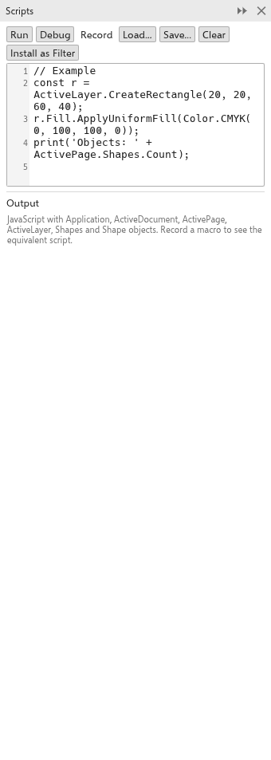

# Skripty a automatizace

Skripty automatizují opakovanou práci: kreslí tvary z dat, mění mnoho objektů
najednou nebo přidávají formát souborů. Píší se v jazyce JavaScript v panelu
[[docker.scripts]] ([[menu.tools > menu.tools.scripts >
menu.tools.scripts_docker]]).



## Psaní a spouštění skriptů {#run}

Skript pracuje s objekty TraceDraw: `Application`, `ActiveDocument`,
`ActivePage`, `ActiveLayer` a tvary, výplněmi, obrysy, barvami, křivkami a
efekty. Například:

```js
for (let i = 0; i < 5; i++) {
  ActiveLayer.CreateRectangle(10 + i * 25, 10, 20, 20);
}
```

- [[docker.run]] spustí skript. Jeho změny jsou jeden krok zpět.
- [[docker.record]] nahraje, co děláte, jako skript (také
  [[menu.tools > menu.tools.scripts > menu.tools.scripts_record]]).
- [[docker.load]] a [[docker.save]] otevírají a ukládají skripty;
  [[menu.tools.scripts_run]] spustí soubor skriptu.
- [[docker.clear]] vyprázdní editor; [[docker.output]] ukazuje, co skript
  vypisuje, a jeho chyby.

## Ladění {#debug}

V desktopové verzi klikněte do okraje editoru a nastavte zarážku, pak
klikněte na [[docker.debug]]. Skript se na zarážce zastaví: **Pokračovat**,
**Krok** nebo **Zastavit**; zadáním výrazu jej vyhodnotíte v místě, kde je
skript pozastaven.

## Filtry skriptů {#filters}

Skript, který definuje `TraceDrawFilter` s názvem, příponami a funkcí
`Import` nebo `Export`, přidá formát souborů do [[menu.file.import]] a
[[menu.file.export]]. Kliknutím na [[docker.install_filter]] jej uchováte;
[[docker.script_filters]] uvádí nainstalované filtry s tlačítky
[[docker.edit]] a [[docker.remove]].

## Asistenti AI (MCP) {#mcp}

TraceDraw umí protokol Model Context Protocol, takže asistenti AI ve vašem
počítači mohou kresby otevírat, upravovat, zkoumat, exportovat a ukládat:

- `tracedraw --mcp` spustí TraceDraw bez okna pro asistenta.
- Aby asistent mohl upravovat kresbu otevřenou ve vašem okně, zapněte
  [[options.mcp_window]] na stránce [[options.general]] v
  [[menu.tools > menu.tools.options > menu.tools.options_global]] a dejte
  asistentovi jako příkaz `tracedraw --mcp-window`. Každá změna je jeden krok
  zpět, který můžete vrátit. Připojit se mohou jen programy ve vašem
  počítači s tajným tokenem, který TraceDraw zapíše.

## Nástroj příkazového řádku {#cli}

Každé stažení obsahuje také `tracedraw-cli`, který převádí kresby mezi
formáty bez otevření programu, pro dávkovou práci.
