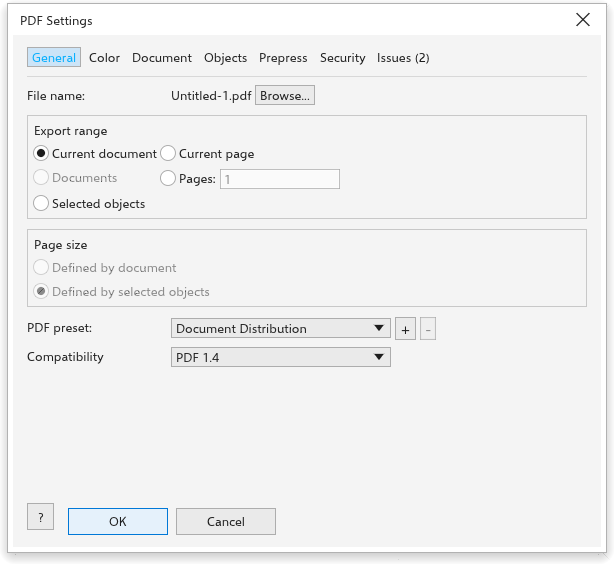
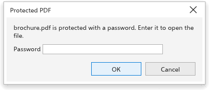

# Publishing to PDF

[[menu.file > menu.file.publish_to_pdf]] (also on the standard toolbar) writes
a PDF file with full control of what goes in: which pages, which PDF standard,
document information, bookmarks and password protection.

## General {#general}

- **File name**, with **Browse** to choose another place.
- **Export range**: the current document (every page), every open document,
  the current page, a list of pages (such as `1-3, 5`), or the selection.
- **Page size** for a selection: the page of the document, or a page the size
  of the selected objects.
- **PDF preset**: Document Distribution, Web, Prepress (PDF/X-4), PDF/X-1a,
  PDF/X-3, or your own; **+** saves the current settings as a preset and
  **-** deletes one.
- **Compatibility**: PDF 1.4, PDF/X-1a:2003, PDF/X-3:2003 or PDF/X-4. PDF/X
  files are made for print shops.

## Color {#color}

For PDF/X, the **output condition** (FOGRA39 at first); the CMYK profile of
the drawing goes into the file. A plain PDF keeps the colors as they are.

## Document {#document}

**Title**, **Author**, **Subject** and **Keywords**, filled in from the
drawing's properties; **a bookmark for each page** (on at first) and **show
the bookmarks when the file opens**.

## Objects and prepress {#objects}

- **Flatten transparency at** a resolution (300 dpi), for PDF/X-1a and X-3,
  which do not allow transparency.
- **Bleed** (0 to 50 mm) around every page.

## Security {#security}

- **Require a password to open the file**, and the password.
- **Restrict printing, copying and changes with a password**, and the
  password, then the **permissions**: printing (not allowed, low resolution
  only, allowed), copying, changing the content, adding comments, filling in
  forms, managing pages and text access for screen readers.
- **Show passwords**.

PDF/X files cannot be protected. The passwords are never kept.

## Issues {#issues}

The last tab lists what the preflight check finds; see
[Preflight](../printing/preflight.md). Click [[dialog.ok]] to write the file.
If something is missing, such as a password or a page in the list, the dialog
box says so in red.

## Opening protected PDF files {#password}

When you open or import a PDF that needs a password, the
[[pdf_password.title]] dialog box asks for it. Type the
[[publish.password]] and click [[dialog.ok]]. A wrong password is refused and
you can try again; [[dialog.cancel]] leaves the file closed.

